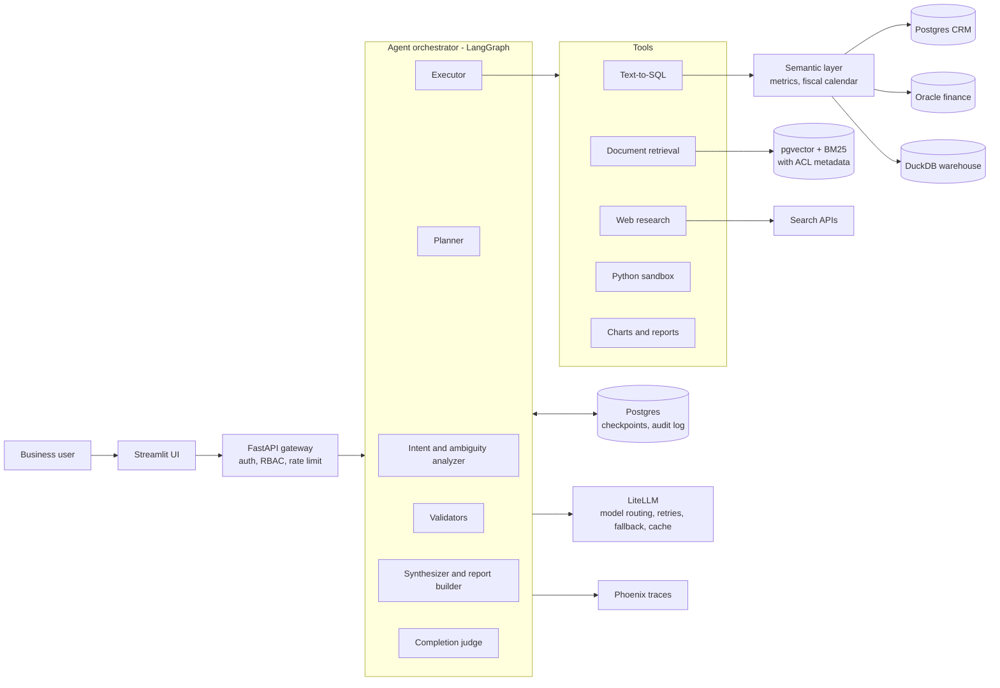
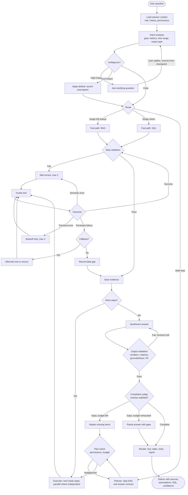
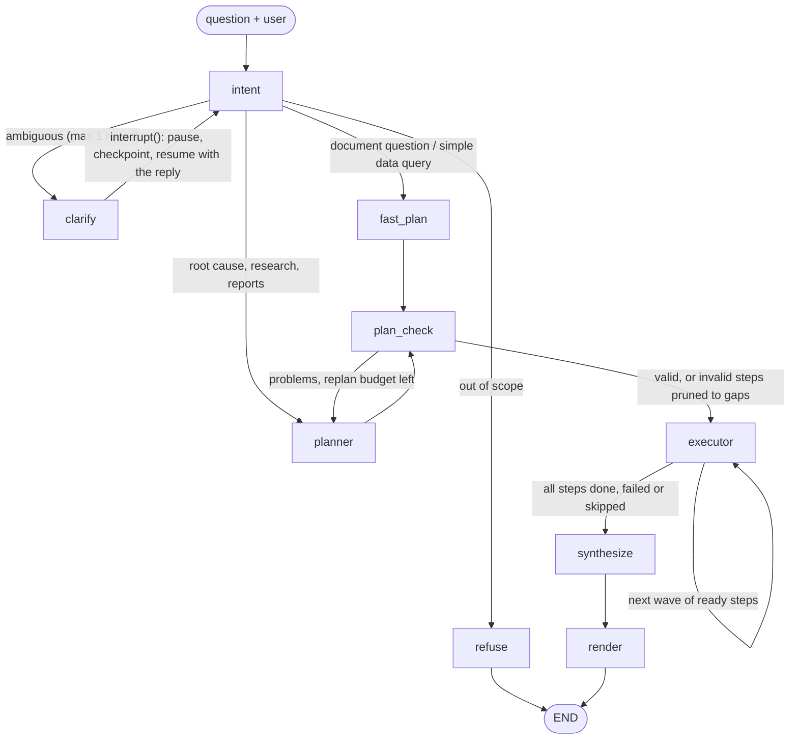

# Architecture

## Platform components

## Agent workflow

### The graph as built

The LangGraph graph in `src/analytics_platform/agent/graph.py` implements this workflow. The step
and output validators and the completion judge arrive in milestone 5. Until then the renderer
derives gaps from the synthesiser's contract coverage, failed steps and budget stops.

Each executor wave runs every step whose dependencies are done, concurrently. Inside a step:

- **Retries:** transient errors and timeouts are retried with exponential backoff and jitter.
  Permission, invalid-input and unavailable errors are not retried.
- **Circuit breaker:** a dependency that fails repeatedly is skipped for a cooldown. The breaker
  is shared across requests, and SQL databases have their own breakers.
- **Fallback:** if the CRM or finance database is down, free-form SQL runs again without it.
  Governed metrics always come from the warehouse, which holds a copy of both.
- **Skipping:** a step whose inputs failed, or returned nothing, is skipped and recorded.
- **Budgets:** each request has limits on tool calls, LLM calls, cost and time, checked before
  every wave. When one runs out, the remaining steps become gaps in a partial answer.

State is checkpointed in Postgres (schema `agent`) after every node. The deserialiser only
accepts the agent's own state types.

## Key decisions

- **The completion judge is deterministic.** An "answer contract" (a checklist of what a complete answer
  needs) is created during intent analysis. The task is done when every item is backed by validated
  evidence, or recorded as a gap once the budget is spent. The LLM saying "done" is not enough.
- **A semantic layer sits between the LLM and the databases.** Metrics like revenue are defined once,
  so the SQL agent composes governed definitions instead of guessing join logic.
- **LLM calls go through one client** (`analytics_platform.llm`): model tiers (fast, strong, judge),
  retries on transient errors only, fallback models, a Redis response cache, and per-run cost tracking
  via `track_usage()`. Tests use `FakeLLM`, so CI never calls a paid API.
- **The agent's database role is read-only** (`analyst_ro`): enforced by Postgres, not by prompts.
